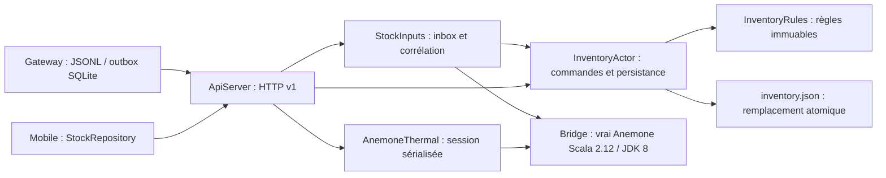

# Domaine, messages et cycle de vie — SS-002

## Architecture S1

Le module canonique est `code/smartstock-agent`. JDK 21, sbt 1.10.7,
Scala 2.13.16 et Akka Typed 2.6.20 sont épinglés. Les versions Scala/Akka viennent
du travail d'Ayoub ; sbt 1.x sert à reproduire la compilation vérifiée.

`EventEnvelope` contient identité, source, séquence, horodatage et événement typé.
Les événements immuables représentent DataMatrix, variation de poids, température,
humidité, présence IR et panne. Ils représentent des observations ; un scan seul
ne signifie pas un retrait. Le DTO Scala est interne : ce n'est pas encore un
codec JSON de l'enveloppe transport v1 (qui contient aussi v/type/corr/data).

`EventRouter.Forward(envelope, replyTo)` classe et transmet vers trois ports
injectés : stock, environnement et alertes. Chaque port reçoit
`Delivery(envelope, replyTo)` et répond `Accepted(id)`. Le routeur répond
`Forwarded(id)` ou `Rejected(id, reason)`. L'accusé signifie acceptation par le
destinataire, pas retrait physique confirmé ni persistance métier.

Les acteurs de simulation repris d'Ayoub sont séparés du chemin de routage.
BatchActor maintient lots et historique en mémoire ; les trois acteurs capteurs
interprètent des mesures injectées. Ils ne remplacent ni les cartes d'acquisition,
ni Anemone, ni un service de stock persistant.

## Concurrence, erreurs et arrêt

Un ask Future par transmission, timeout configurable (2 s par défaut), puis
pipeToSelf. La fermeture sur replyTo et id conserve la corrélation de chaque
demande, même si les réponses arrivent dans le désordre. Aucun Await dans les
acteurs ; seul le point d'entrée CLI attend la terminaison du système (10 s maximum).
Un accusé incorrect, une absence de réponse ou une destination arrêtée deviennent
un rejet. Les valeurs non finies, humidité hors 0–100, code vide et métadonnées
invalides sont rejetés. Un délai ne prouve pas que le destinataire n'a rien traité :
le transport durable devra retransmettre le même id et dédupliquer côté réception.

Le guardian de démonstration crée les ports simulés et le routeur, envoie un
événement puis s'arrête à réception du résultat. Ses enfants s'arrêtent avec lui.
Un arrêt externe utilise ActorSystem.terminate ; les demandes en vol ne sont pas
persistées dans ce socle. La file SQLite est une simulation séparée du transport.

## Exigences académiques et preuves

| Concept | Utilité et localisation |
|---|---|
| case classes / traits | Événements et protocoles Event, EventRouter |
| pattern matching | Choix du port et traitement du résultat asynchrone |
| collections immuables | Map de lots et Vector d'historique de BatchActor |
| Option | Destination facultative et erreur facultative du routeur |
| Try | Conversions UUID, séquence, Instant dans EventEnvelope.parse |
| for-comprehension | Composition de ces conversions sans perdre l'erreur |
| Future | Ask non bloquant du destinataire, vérification de l'accusé |
| acteurs / messages | Guardian, routeur, ports typés et simulateurs |
| échec / latence | Timeout, rejet, accusé incorrect et réponse tardive testés |

Tests : EventRouterSpec, SensorAndWithdrawalSpec et deux suites reprises.
La simulation 40 → 39 teste un retrait explicite de lot et son historique ; elle
ne prouve pas la corrélation DataMatrix/poids de bout en bout ni Anemone.

## Service produit : HTTP, stockage et Anemone

`ServiceMain` est le serveur persistant ; `Main` conserve la démonstration S1.
`InventoryActor` sérialise les commandes ; ses écritures s’exécutent sur le
dispatcher de stockage dédié. `ApiServer` utilise des asks asynchrones. Une erreur
d’écriture ne publie pas le nouvel état. Les commandes UUID sont idempotentes.

`StockInputs` journalise les observations avant acquittement, reconstruit les
couples après redémarrage et utilise Anemone pour confirmer les retraits. Le
mouvement vérifie le stock attendu avant écriture ; une modification concurrente
est refusée. Les ajouts et corrections passent par les règles de stock séparées.
`AnemoneThermal` sérialise la session thermique et lit la puissance décidée par
le vrai moteur. Les unités et limites des modèles sont dans le README du bridge.

| Concept | Preuve dans le service produit |
| --- | --- |
| case classes / traits | InventoryOperation, Product, Batch, InventoryActor.Command |
| immutabilité / pattern matching | InventoryRules.execute et Correlator |
| Option / Either | expectedBefore, recherche des lots, DomainError et validation |
| for-comprehension / Future | AnemoneThermal.evaluate, appels HTTP asynchrones AnemoneClient |
| acteurs | InventoryActor : protocole typé, sérialisation et lecture de l’état |
| concurrence | ConcurrentApiSpec : écritures distinctes, réémissions et dernier article |
| reprise / erreurs | InventorySpec, StockInputsSpec, ApiSpec |
| vrai moteur | AnemoneIntegrationSpec et StockInputsSpec avec SMARTSTOCK_ANEMONE_URL |

Commandes de lancement et tests : [démarrage local](../DEMARRAGE.md).
Les simulations S1 restent distinctes de ce service ; aucun test local ne valide
le câblage, la calibration, le BLE ou les actionneurs physiques.
